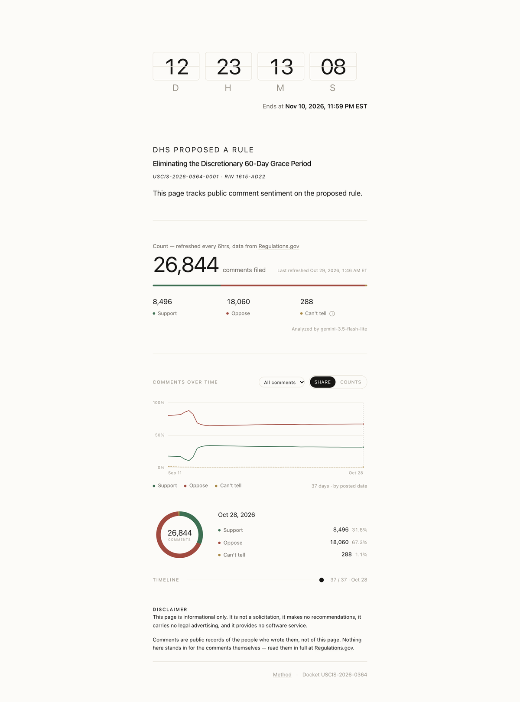

# DHS Public Comments Tracker

Counting public comments on DHS's proposed rule to eliminate the discretionary 60-day grace period — how many support it, how many oppose it, refreshed every 6 hours.

**→ https://raph651.github.io/h1b-grace-period-comments-tracker/**

Source: [Regulations.gov docket USCIS-2026-0364](https://www.regulations.gov/document/USCIS-2026-0364-0001/comment). Comments are public records; this page is informational only and makes no recommendations.
